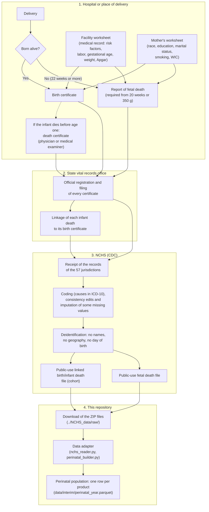

# Data source: how the NCHS files are produced

This document explains where the model's data come from: how the information on each delivery travels from the hospital to the public-use files downloaded from the National Center for Health Statistics (NCHS). Spanish version: [`data_source_nchs_es.md`](data_source_nchs_es.md).

## 1. What NCHS is

The **National Center for Health Statistics** (NCHS) is the official health statistics agency of the United States government and part of the **Centers for Disease Control and Prevention** (CDC). It runs the **National Vital Statistics System** (NVSS), which brings together the official birth, death and fetal death certificates of the whole country.

In the US, registering births and deaths is the responsibility of each state. NCHS does not collect data in hospitals: it receives them from the states' vital records offices under a cooperative agreement and unifies them into national files.

## 2. The full flow

## 3. Each step, explained

| Step | Who | What happens | What it means for the model |
|---|---|---|---|
| 1. Delivery | Hospital, birth center or midwife | If the infant is born alive, the **birth certificate** is completed; if it is a fetal death, the **report of fetal death**. Both use the national standard format (2003 revision). The information comes from two worksheets: the **facility worksheet**, completed from the medical record, and the **mother's worksheet**, which she answers | Predictors are what was written on the form, not clinical measurements. Some risk factors (diabetes, hypertension) are recorded less often than they occur |
| 1b. Infant death | Physician, medical examiner or funeral director | If the infant dies before age one, a **death certificate** with the cause is completed | It provides the age at death that defines early neonatal death (0 to 6 days) |
| 2. State | Vital records office | Officially registers every certificate and **links each infant death to its birth certificate** | About 1% of deaths cannot be linked; those infants appear as survivors |
| 3. NCHS | National Center for Health Statistics | Receives the records of the 57 jurisdictions (50 states, the District of Columbia, New York City and 5 territories). It **codes** causes of death in ICD-10, **edits** for consistency, **imputes** some missing values (weight, gestational age, sex; they are flagged) and **deidentifies**: removes names, addresses, geography and day of birth | The data are national and standardized, but there is no mother identifier and no geography |
| 3b. Public-use files | NCHS | Publishes every year, as fixed-width files inside a ZIP with a user guide: (a) **linked births and infant deaths**, which includes **all** live births, whether or not they died; (b) **fetal deaths** | The model uses the cohort version of file (a): all births of a year, followed to age one |
| 4. This repository | Data adapter | Reads the ZIP files without extracting them, builds each year's cohort, joins live births and fetal deaths, and keeps only the prenatal fields present in both files | The perinatal population results: one row per product of 22 weeks or more, with its label |

## 4. What the model population contains

The population is **not deaths only**. It includes every product of 22 weeks or more of each year, with or without an event. Example, 2023:

| Component | Products | With a perinatal event |
|---|---|---|
| Live births | 3,589,826 | 7,089 died between day 0 and day 6 |
| Fetal deaths | 15,248 | 15,248 (all are events) |
| **Total** | **3,605,074** | **22,337 (6.2 per 1,000)** |

The 3,582,737 products without an event (live births who survived the first week) are the reference against which the model learns to distinguish high-risk pregnancies.

## 5. Conditions of use

- The files are public, but their use is governed by the NCHS data use agreement: statistical analysis only, no attempt to identify any person and no linkage with identifiable data.
- They are not redistributed in this repository: they are kept in `../NCHS_data/raw/` and only the code is published.
- Reports show no cell with fewer than 10 cases.

*Confidential: internal use of the research project.*
