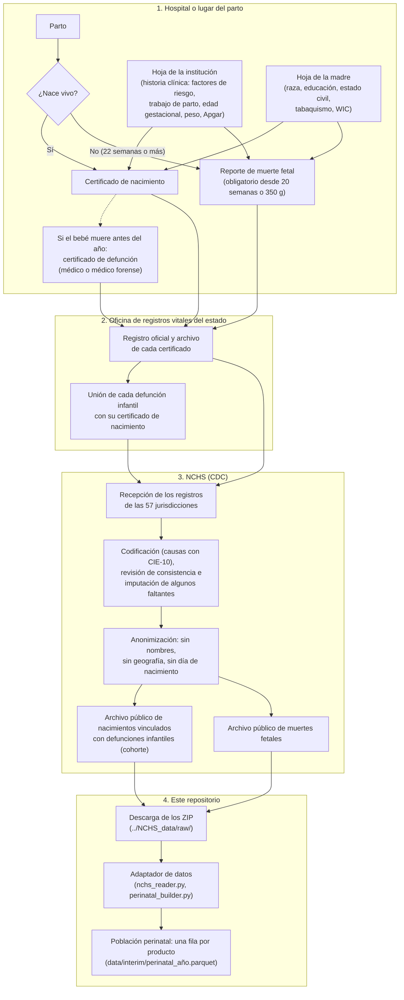

# Fuente de datos: cómo se producen los archivos de NCHS

Este documento explica de dónde salen los datos del modelo: cómo la información de cada parto pasa del hospital a los archivos públicos que se descargan del National Center for Health Statistics (NCHS). Versión en inglés: [`data_source_nchs.md`](data_source_nchs.md).

## 1. Quién es NCHS

El **National Center for Health Statistics** (NCHS) es la agencia oficial de estadísticas de salud del gobierno de Estados Unidos y forma parte de los **Centers for Disease Control and Prevention** (CDC). Administra el **National Vital Statistics System** (NVSS), que reúne los certificados oficiales de nacimiento, defunción y muerte fetal de todo el país.

En EE. UU. el registro de nacimientos y defunciones es responsabilidad de cada estado. NCHS no recoge los datos en los hospitales: los recibe de las oficinas de registros vitales de los estados, en virtud de un convenio de cooperación, y los unifica en archivos nacionales.

## 2. El flujo completo

## 3. Cada paso, explicado

| Paso | Quién | Qué pasa | Qué significa para el modelo |
|---|---|---|---|
| 1. Parto | Hospital, centro de parto o partera | Si el bebé nace vivo se llena el **certificado de nacimiento**; si es una muerte fetal, el **reporte de muerte fetal**. Ambos usan el formato estándar nacional (revisión de 2003). La información sale de dos hojas: la **de la institución**, que se llena con la historia clínica, y la **de la madre**, que ella responde | Los predictores son lo que se escribió en el formulario, no mediciones clínicas. Algunos factores de riesgo (diabetes, hipertensión) se registran menos de lo que ocurren |
| 1b. Defunción infantil | Médico, médico forense o funeraria | Si el bebé muere antes del año, se llena un **certificado de defunción** con la causa | De aquí sale la edad al morir que define la muerte neonatal precoz (0 a 6 días) |
| 2. Estado | Oficina de registros vitales | Registra oficialmente cada certificado y **une cada defunción infantil con su certificado de nacimiento** | Cerca del 1% de las defunciones no se logra unir; esos bebés aparecen como sobrevivientes |
| 3. NCHS | National Center for Health Statistics | Recibe los registros de las 57 jurisdicciones (50 estados, el Distrito de Columbia, la ciudad de Nueva York y 5 territorios). **Codifica** las causas de muerte con CIE-10, **revisa** la consistencia, **imputa** algunos datos faltantes (peso, edad gestacional, sexo; quedan marcados) y **anonimiza**: quita nombres, direcciones, geografía y día de nacimiento | Los datos son nacionales y estandarizados, pero no hay identificador de la madre ni geografía |
| 3b. Archivos públicos | NCHS | Publica cada año, en archivos de ancho fijo dentro de un ZIP y con una guía de usuario: (a) **nacimientos vinculados con defunciones infantiles**, que incluye **todos** los nacidos vivos, hayan muerto o no; (b) **muertes fetales** | El modelo usa la versión cohorte del archivo (a): todos los nacidos de un año, seguidos hasta un año de vida |
| 4. Este repositorio | Adaptador de datos | Lee los ZIP sin descomprimirlos, arma la cohorte de cada año, une los nacidos vivos y las muertes fetales, y conserva solo los campos prenatales presentes en los dos archivos | Queda la población perinatal: una fila por producto de 22 semanas o más, con su etiqueta |

## 4. Qué contiene la población del modelo

La población **no es solo de muertes**. Incluye todos los productos de 22 semanas o más de cada año, con o sin evento. Ejemplo, 2023:

| Componente | Productos | Con evento perinatal |
|---|---|---|
| Nacidos vivos | 3.589.826 | 7.089 murieron entre el día 0 y el día 6 |
| Muertes fetales | 15.248 | 15.248 (todas son evento) |
| **Total** | **3.605.074** | **22.337 (6,2 por 1.000)** |

Los 3.582.737 productos sin evento (nacidos vivos que sobrevivieron la primera semana) son la referencia contra la que el modelo aprende a distinguir los embarazos de alto riesgo.

## 5. Condiciones de uso

- Los archivos son públicos, pero su uso se rige por el acuerdo de uso de datos de NCHS: solo análisis estadístico, sin intentar identificar a ninguna persona y sin unirlos con datos identificables.
- No se redistribuyen en este repositorio: se guardan en `../NCHS_data/raw/` y se publica solo el código.
- Los reportes no muestran celdas con menos de 10 casos.

*Confidencial: uso interno del proyecto de investigación.*
