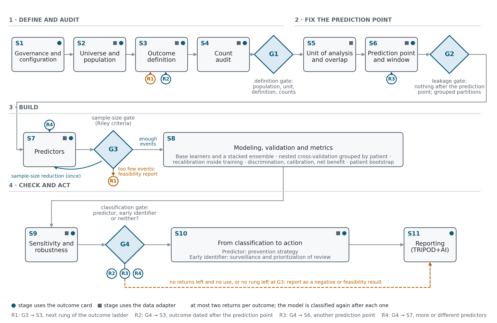

# Staged framework for clinical prediction models — version 1.0

Version 1.0. The staged framework that this model follows from the definition of the outcome to the report. Spanish version: [`framework_es.md`](framework_es.md).

> **Nomenclature.** English files use stages S1 to S11 and gates G1 to G4. Spanish files use E1 to E11 and P1 to P4 for the same stages and gates.

*Figure. The staged framework. A dot marks the stages that use the outcome card and a square those that use the data adapter; unmarked stages are reused unchanged. S: stage; G: gate; R: return.*

## 1. What the framework answers

A model with good discrimination may predict events that have not yet happened, or it may only recognize events already under way when the prediction is made. The framework takes any adverse outcome from definition to reporting and ends by classifying the fitted model as a **predictor**, an **early identifier** or **neither**.

## 2. Three layers

| Layer | Holds | Changes when |
|---|---|---|
| **Core** | Stages, gates, validation, metrics, classification rule, reporting | Never between outcomes |
| **Outcome card** | Rung on the outcome ladder, population, event definition and timing, prediction point, own predictors, reduced predictor set, primary learner, sensitivity set, expected counts | A new outcome needs a new card |
| **Data adapter** | Code that turns one data source into the contract table | A new data source needs a new adapter |

The core reads only the **contract table**: one row per unit of analysis with `unit_id`, `group_id` (never split between training and test), `t0` (time zero), `t_pred` (prediction point), the main label and sensitivity labels as columns, each predictor with an indicator of whether it was measured, and `period` (calendar period or coding era). In this model the contract table is `data/contract/perinatal_nchs_v1.parquet`, built by the data adapter (`libraries/nchs_reader.py`) from the NCHS public-use files.

## 3. Stages and gates

| Block | Stage or gate | Question | Card | Adapter |
|---|---|---|---|---|
| Define and audit | **S1** Governance and configuration | What is fixed before anything runs? | • | |
| | **S2** Universe and population | Which units can be studied? | • | ■ |
| | **S3** Outcome definition | What counts as an event, from which sources, and when did it happen? | • | ■ |
| | **S4** Count audit | How many events, where, when, with what overlap? | • | ■ |
| | **G1** Definition gate | Are population, unit and definition fixed, and do the reference counts reproduce? | | |
| Fix the prediction point | **S5** Unit of analysis and overlap | What is one record, and what must stay on one side of a split? | | ■ |
| | **S6** Prediction point and window | When is the prediction made and what information may it use? | • | ■ |
| | **G2** Leakage gate | Does nothing after the prediction point enter, and are partitions grouped by patient? | | |
| Build | **S7** Predictors | Which variables, with what coverage and limits? | • | ■ |
| | **G3** Sample-size gate | Are there enough events for the candidate parameters (Riley et al.)? | | |
| | **S8** Modeling, validation and metrics | How well does it work, with what uncertainty? | | |
| Check and act | **S9** Sensitivity and robustness | Does it survive other reasonable choices, including criteria C1 to C4? | • | ■ |
| | **G4** Classification gate | Predictor, early identifier or neither? | | |
| | **S10** From classification to action | What use fits the class, and is it fair across subgroups? | • | ■ |
| | **S11** Reporting (TRIPOD+AI) | What is delivered? | • | |

No model is fitted before G3. Every decision goes to the **decision log** with its date, the options considered, the option chosen, the reason, the type of reason (clinical, methodological or technical) and who validated it.

## 4. The gates in detail

**G1, definition.** Population, unit and event definition are fixed and the reference counts can be reproduced (an `EXPECTED` check stops any run whose population is not the audited one).

**G2, leakage.** No information after the prediction point enters the model (no diagnoses, procedures, DRG codes or treatments of the same admission), and every partition is grouped by patient. Imputation, scaling, tuning, stacking and recalibration are fitted inside the training part.

**G3, sample size.** The criteria of Riley et al. (expected shrinkage of 0.9 or more, optimism in explained variation of 0.05 or less, precise overall risk) give the minimum number of units and events for the candidate parameters, using the observed Cox-Snell R² of a cross-validated logistic regression (or an assumed value when no model can be fitted). If the data fall short, the outcome is reported as a feasibility analysis and return R1 moves to the next rung of the outcome ladder.

**Sample-size reduction.** When a model meets every applicable criterion of G4 but fails G3, it may be refitted **once** with a reduced predictor set that does not exceed the parameters the data support. The reduced set is fixed in the outcome card by rules (collapse categories, keep the core clinical variables), never by the association of a predictor with the outcome. The reduced model must pass G3 and is classified again at G4 with the same thresholds. It is not a return.

**G4, classification.** Four criteria, each tested with a prespecified sensitivity analysis:

| Criterion | Question | Passed if |
|---|---|---|
| C1, events already present | How much does performance fall when events present at the prediction point are removed (landmark population)? | AUROC falls by 0.05 or less and at least two thirds of the AUPRC gain over prevalence is kept |
| C2, outcome with time | Does performance hold for events dated after the prediction point? | AUROC of 0.75 or more, with a lower 95% limit of 0.70 or more |
| C3, detection bias | Does performance hold among patients who were tested, when the outcome depends on a test? | AUROC falls by 0.05 or less |
| C4, stability over time | Does the model discriminate and calibrate in a later period? | Temporal AUROC of 0.70 or more, and calibration correctable by the intercept alone |

- **Predictor:** AUROC of 0.75 or more in the landmark population or on an outcome with time, and passes C1 to C4. Proceeds to a prevention strategy.
- **Early identifier:** AUROC of 0.75 or more with the full label and the top 10% of risk holds at least twice the events expected by chance, but fails C1, C3 or C4. Suited to surveillance and prioritization of review, not to prevention.
- **Neither:** otherwise, or a temporal AUROC below 0.65.

A criterion that cannot apply to an outcome (for example C3 when the outcome does not depend on a test) is marked *not applicable* in the card, with the reason, before any model is fitted.

## 5. Returns and the outcome ladder

| Return | From | To | What changes |
|---|---|---|---|
| R1 | G3 | S3 | Next rung of the outcome ladder |
| R2 | G4 | S3 | An outcome dated after the prediction point |
| R3 | G4 | S6 | Another prediction point |
| R4 | G4 | S7 | More or different predictors |

At most two returns per outcome; every return is reported and the model is classified again after each one. With no return left and no use, or no rung left at G3, the result goes to S11 as negative or feasibility.

**Outcome ladder** (three rungs): the ideal outcome; a more frequent surrogate on the same clinical path; an outcome dated after the prediction point.

## 6. Modeling rules (S8)

- Nested cross-validation grouped by patient (5 outer folds × 3 repeats, inner grouped folds), Platt recalibration inside training, patient-level bootstrap intervals.
- Metrics: AUROC, AUPRC against prevalence, Brier score, calibration slope and intercept, observed-to-expected ratio, expected calibration error, share of events in the top 5% and 10% of risk, decision curve.
- Base learners: penalized logistic regression, random forest, extra trees, XGBoost; stacked ensemble with a logistic meta-learner as a comparison. The ensemble is adopted only if it outperforms the best base learner consistently.
- **Primary learner by events per parameter (pending the supervisor's validation).** Fixed in the outcome card before any model: with fewer than 20 events per candidate parameter, penalized logistic regression is the primary model and the others are comparisons; with 20 or more, the best base learner of a preliminary run.
- No resampling in the main analysis (imbalance corrections harm calibration); class weights and resampling only as sensitivity.

## 7. Principles that do not change

1. Audit before model.
2. Rules are measured as columns first and applied as filters afterwards, each with its sensitivity analysis.
3. The label is a documented proxy: verified code catalogue (title, tier, source, date) and a label table with sensitivity definitions as columns.
4. Prediction point and window are fixed before the predictors.
5. Every choice is a numbered decision in the log.
6. Aggregate outputs only; small cells suppressed; no identifiers in any published file.
7. Notebooks and documents in EN/ES pairs with identical code, fixed configuration, TRIPOD+AI reporting.

*Confidential: internal use of the research project.*
